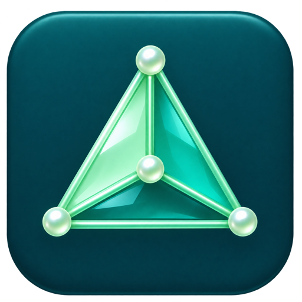

## 点群与基函数 0.6.0

0.6.0 新增 39 个常见有机物模型和 21 个配合物模型。离线库现有 221 个候选结构，覆盖 196 种按电荷区分的化学式。

在振动光谱的「结构目录」可按名称浏览有机物和配合物，也可输入化学式。输入 `C4H8` 可比较顺式和反式 2-丁烯、异丁烯及环丁烷。输入 `Pt(NH3)2Cl2` 可比较顺铂与反铂。输入 `[Fe(CN)6]4-` 可指定亚铁氰根，省略电荷则同时列出铁(II)和铁(III)候选。每次选择后，先核对三维结构并确认，再计算红外和拉曼选择定则。全部坐标随应用提供，Android 离线即可使用。

新增有机物中，17 个模型采用 NIST CCCBDB 参考坐标，经重新定向和对称化以处理坐标舍入误差。α/β-D-吡喃葡萄糖和 D/L-丙氨酸采用 PubChem 计算构象。其余新增模型采用理想化几何，配合物显式包含配体上的原子。二茂铁提供重叠式与交错式两种环取向。原有碳、硅四面体取代模型仍可按化学式查询。项目 JSON 保存所选候选、电荷（如有）和用于计算的完整坐标。 [NIST CCCBDB](https://cccbdb.nist.gov/exp2x.asp?casno=74840&charge=0) · [PubChem](https://pubchem.ncbi.nlm.nih.gov/compound/79025)

| 平台 | 下载 | 安装与启动 |
|---|---|---|
| Debian / Ubuntu 图形桌面 | [BasisCharacter-0.6.0-Linux-all.deb](https://github.com/lightzfpwings/pointgroup-reducer/releases/download/basis-v0.6.0/BasisCharacter-0.6.0-Linux-all.deb) | 在下载目录执行 `sudo apt install ./BasisCharacter-0.6.0-Linux-all.deb`，从应用菜单打开「点群与基函数」或运行 `basis-character`。系统通过 xdg-utils 在默认图形浏览器中打开本地页面。 |
| Apple 芯片 Mac，macOS 12 或更新版本 | [BasisCharacter-0.6.0-macOS-arm64.dmg](https://github.com/lightzfpwings/pointgroup-reducer/releases/download/basis-v0.6.0/BasisCharacter-0.6.0-macOS-arm64.dmg) | 打开 DMG，将 `BasisCharacter.app` 拖入「应用程序」后启动。 |
| Windows x64 | [BasisCharacter-0.6.0-Windows-x64.zip](https://github.com/lightzfpwings/pointgroup-reducer/releases/download/basis-v0.6.0/BasisCharacter-0.6.0-Windows-x64.zip) | 完整解压 ZIP 后打开 `BasisCharacter.exe`。若缺少 WebView2，先运行随包提供的微软离线运行时安装程序。 |
| Android 8.0 或更新版本 | [BasisCharacter-0.6.0-Android.apk](https://github.com/lightzfpwings/pointgroup-reducer/releases/download/basis-v0.6.0/BasisCharacter-0.6.0-Android.apk) | 在设备上打开 APK 并按系统提示安装。应用需要 Android System WebView 或 Chrome 内核 109 及以上，系统文件选择器可打开 XYZ，也可载入和保存 JSON 项目。 |

Mac 应用使用临时签名，DMG 未经 Apple 公证。Windows 主程序没有 Authenticode 发布者签名，包内的 WebView2 安装程序带有微软签名。Android APK 使用项目的独立签名密钥，后续覆盖安装须使用同一签名身份。系统可能提示无法验证桌面软件发布者。 如需直接使用浏览器，可下载三语独立 HTML。发布页还提供源码与 `SHA256SUMS.txt`。

## 點群與基函數 0.6.0

0.6.0 新增 39 個常見有機物模型及 21 個配合物模型。離線庫現有 221 個候選結構，涵蓋 196 種依電荷區分的化學式。

在振動光譜的「結構目錄」可依名稱瀏覽有機物與配合物，也可輸入化學式。輸入 `C4H8` 可比較順式與反式 2-丁烯、異丁烯及環丁烷。輸入 `Pt(NH3)2Cl2` 可比較順鉑與反鉑。輸入 `[Fe(CN)6]4-` 可指定亞鐵氰根，省略電荷則同時列出鐵(II)與鐵(III)候選。每次選擇後，先核對三維結構並確認，再計算紅外與拉曼選擇定則。全部座標隨應用程式提供，Android 可離線使用。

新增有機物中，17 個模型採用 NIST CCCBDB 參考座標，經重新定向與對稱化以處理座標捨入誤差。α/β-D-吡喃葡萄糖與 D/L-丙胺酸採用 PubChem 計算構象。其餘新增模型採用理想化幾何，配合物明確包含配體上的原子。二茂鐵提供重疊式與交錯式兩種環取向。原有碳、矽四面體取代模型仍可依化學式查詢。專案 JSON 儲存所選候選、電荷（如有）與用於計算的完整座標。 [NIST CCCBDB](https://cccbdb.nist.gov/exp2x.asp?casno=74840&charge=0) · [PubChem](https://pubchem.ncbi.nlm.nih.gov/compound/79025)

| 平台 | 下載 | 安裝與啟動 |
|---|---|---|
| Debian / Ubuntu 圖形桌面 | [BasisCharacter-0.6.0-Linux-all.deb](https://github.com/lightzfpwings/pointgroup-reducer/releases/download/basis-v0.6.0/BasisCharacter-0.6.0-Linux-all.deb) | 在下載目錄執行 `sudo apt install ./BasisCharacter-0.6.0-Linux-all.deb`，從應用程式選單開啟「點群與基函數」或執行 `basis-character`。系統透過 xdg-utils 在預設圖形瀏覽器中開啟本機網頁。 |
| Apple 晶片 Mac，macOS 12 或更新版本 | [BasisCharacter-0.6.0-macOS-arm64.dmg](https://github.com/lightzfpwings/pointgroup-reducer/releases/download/basis-v0.6.0/BasisCharacter-0.6.0-macOS-arm64.dmg) | 開啟 DMG，將 `BasisCharacter.app` 拖入「應用程式」後啟動。 |
| Windows x64 | [BasisCharacter-0.6.0-Windows-x64.zip](https://github.com/lightzfpwings/pointgroup-reducer/releases/download/basis-v0.6.0/BasisCharacter-0.6.0-Windows-x64.zip) | 完整解壓縮 ZIP 後開啟 `BasisCharacter.exe`。若缺少 WebView2，先執行隨附的微軟離線執行階段安裝程式。 |
| Android 8.0 或更新版本 | [BasisCharacter-0.6.0-Android.apk](https://github.com/lightzfpwings/pointgroup-reducer/releases/download/basis-v0.6.0/BasisCharacter-0.6.0-Android.apk) | 在裝置上開啟 APK 並依系統提示安裝。應用程式需要 Android System WebView 或 Chrome 核心 109 及以上，系統檔案選擇器可開啟 XYZ，也可載入與儲存 JSON 專案。 |

Mac 應用程式使用臨時簽章，DMG 未經 Apple 公證。Windows 主程式沒有 Authenticode 發行者簽章，內含的 WebView2 安裝程式帶有微軟簽章。Android APK 使用專案的獨立簽署金鑰，之後的覆蓋安裝須使用相同的簽署身分。系統可能提示無法驗證桌面軟體發行者。 如需直接使用瀏覽器，可下載三語獨立 HTML。發布頁另有原始碼及 `SHA256SUMS.txt`。

## Point Groups & Basis Functions 0.6.0

Version 0.6.0 adds 39 organic structures and 21 coordination structures. The offline library now contains 221 candidates for 196 formulas when charge states are counted separately.

Browse the structure catalog by name or enter a formula in Vibrational spectroscopy. Try `C4H8` for cis- and trans-2-butene, isobutene and cyclobutane, or `Pt(NH3)2Cl2` for cisplatin and transplatin. Enter `[Fe(CN)6]4-` for hexacyanoferrate(II), or omit the charge to see both Fe(II) and Fe(III). Inspect and confirm the geometry before calculating IR and Raman selection rules. All coordinates are included for offline use on Android and desktop.

Seventeen new organic models use NIST CCCBDB reference coordinates reoriented and symmetrized to remove rounding residuals. The α/β-D-glucose anomers and D/L-alanine enantiomers use PubChem computed conformers. Other additions use idealized geometries with explicit ligand atoms. Ferrocene includes eclipsed and staggered ring orientations. The original tetrahedral carbon and silicon substitution models remain available by formula. Project JSON stores the selected model, its charge where applicable and the full coordinates used in the calculation. [NIST CCCBDB](https://cccbdb.nist.gov/exp2x.asp?casno=74840&charge=0) · [PubChem](https://pubchem.ncbi.nlm.nih.gov/compound/79025)

| Platform | Download | Install and launch |
|---|---|---|
| Debian or Ubuntu desktop | [BasisCharacter-0.6.0-Linux-all.deb](https://github.com/lightzfpwings/pointgroup-reducer/releases/download/basis-v0.6.0/BasisCharacter-0.6.0-Linux-all.deb) | Run `sudo apt install ./BasisCharacter-0.6.0-Linux-all.deb` in the download directory. Open Point Groups & Basis Functions from the applications menu or run `basis-character`. The launcher uses xdg-utils to open the local page in your default graphical browser. |
| Apple silicon Mac, macOS 12 or later | [BasisCharacter-0.6.0-macOS-arm64.dmg](https://github.com/lightzfpwings/pointgroup-reducer/releases/download/basis-v0.6.0/BasisCharacter-0.6.0-macOS-arm64.dmg) | Open the DMG and drag `BasisCharacter.app` into Applications. |
| Windows x64 | [BasisCharacter-0.6.0-Windows-x64.zip](https://github.com/lightzfpwings/pointgroup-reducer/releases/download/basis-v0.6.0/BasisCharacter-0.6.0-Windows-x64.zip) | Extract the entire ZIP and open `BasisCharacter.exe`. If WebView2 is missing, install it using the bundled Microsoft offline runtime installer. |
| Android 8.0 or later | [BasisCharacter-0.6.0-Android.apk](https://github.com/lightzfpwings/pointgroup-reducer/releases/download/basis-v0.6.0/BasisCharacter-0.6.0-Android.apk) | Open the APK on your device and follow the installation prompts. The app requires Android System WebView or a Chrome WebView provider version 109 or later. Use the system picker to open XYZ coordinates and to load or save JSON projects. |

The Mac app has an ad hoc signature and the DMG is unnotarized. The Windows application has no Authenticode publisher signature. Its bundled WebView2 installer is signed by Microsoft. The Android APK uses a dedicated project signing key for installation and future updates. macOS and Windows may display an unverified-publisher warning. Standalone HTML files are also available in all three languages, alongside the source archive and `SHA256SUMS.txt`.

Android APK certificate SHA-256 (io.github.lightzfpwings.basischaracter)

`CC:A2:98:BF:FF:A4:D5:91:3A:AD:4B:07:4E:3C:FD:ED:88:44:02:8F:28:EB:33:6F:08:99:DB:54:D1:A1:5E:52`
